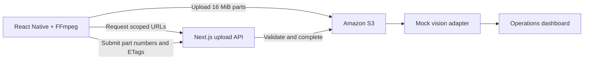

# Hi, I’m Parth 👋

I work on software delivery and infrastructure. Outside work, I build tools for developer workflows, cloud automation, and mobile apps.

  

## Featured projects

<table width="100%">
<tr>
<td width="50%" valign="top">
<b>MOBILE · CLOUD</b>
<h3><a href="https://github.com/parth-nikam/movescan-ops">MoveScan OS</a></h3>

Turn moving-day video into inventory. The prototype pairs React Native capture and resumable S3 uploads with a Next.js operations dashboard.

<a href="https://github.com/parth-nikam/movescan-ops">View source ↗</a> &nbsp;·&nbsp; <a href="https://movescan-ops-demo.parthnikam.chatgpt.site">Live demo ↗</a>

</td>
<td width="50%" valign="top">
<b>AI · DEVELOPER TOOLS</b>
<h3><a href="https://github.com/parth-nikam/relay-ai-copilot-console">Relay AI</a></h3>

Explore how custom GPTs could move into a shared website copilot runtime, with approval gates, traces, and regression evaluations.

<a href="https://github.com/parth-nikam/relay-ai-copilot-console">View source ↗</a> &nbsp;·&nbsp; <a href="https://relay-ai-copilot-demo.parthnikam.chatgpt.site">Live demo ↗</a>

</td>
</tr>
<tr>
<td width="50%" valign="top">
<b>AI · WORKFLOW AUTOMATION</b>
<h3><a href="https://github.com/parth-nikam/enrollment-concierge-agent">Enrollment Concierge</a></h3>

An enrollment agent prototype with consent-gated CRM routing, retry-safe webhooks, and human handoff.

<a href="https://github.com/parth-nikam/enrollment-concierge-agent">View source ↗</a> &nbsp;·&nbsp; <a href="https://enrollment-concierge-proof.parthnikam.chatgpt.site">Live demo ↗</a>

</td>
<td width="50%" valign="top">
<b>iOS · SWIFTUI</b>
<h3><a href="https://github.com/parth-nikam/roads-we-walk-swiftui">RoadsWeWalk</a></h3>

A native SwiftUI prototype for mood check-ins, guided reflections, and sharing with a private circle.

<a href="https://github.com/parth-nikam/roads-we-walk-swiftui">View source ↗</a>

</td>
</tr>
</table>

## Engineering deep dives

### MoveScan OS · Direct-to-S3 video pipeline

- **Control plane and data path.** The API starts the multipart upload and signs individual parts. The client sends video directly to S3 and returns part numbers and ETags for server-side validation.
- **Recovery.** The upload flow supports part-level progress, retry, cancellation, and expired URL recovery. The completion endpoint validates the expected parts and handles repeat submissions idempotently.
- **Demo scope.** The hosted demo uses mock storage and a mock vision adapter. The repository implements the S3 upload path behind the same API contract.

[Source and architecture notes](https://github.com/parth-nikam/movescan-ops#architecture)

### Relay AI · Shared runtime for website copilots

- **Runtime design.** The simulated console shows how each copilot could have its own instructions, knowledge collection, and tool permissions while sharing a runtime.
- **Write controls and debugging.** The demo shows human approval before write actions and exposes citations, conversation traces, latency, token usage, and tool calls for inspection.
- **Evaluation.** Regression examples cover response quality and safety behavior. Model responses, tool calls, and data are simulated.

[Source and proposed production architecture](https://github.com/parth-nikam/relay-ai-copilot-console#production-architecture)

### Enrollment Concierge · Consent and handoff

- **Conversation routing.** Deterministic flows cover qualified leads, financial-aid requests, and policy-sensitive questions, with a human handoff path.
- **Integration contract.** The flow gates CRM routing on consent and demonstrates idempotent webhook payloads. The orchestration contract separates conversation logic from the channel adapter.
- **Demo scope.** Mock connectors let you inspect routing and handoff behavior without real learner data.

[Source and demo overview](https://github.com/parth-nikam/enrollment-concierge-agent)

### RoadsWeWalk · Native SwiftUI product prototype

- **Product flow.** The prototype follows a mood check-in through a guided reflection, a private or Circle sharing choice, and a reflection timeline.
- **State modeling.** The demo includes invitations, connection requests, and free and premium entitlement states. It runs locally with in-memory sample data and mocked authentication and billing.
- **Run locally.** Open `Package.swift` in Xcode 16 or later and run the `RoadsWeWalkDemo` scheme on an iPhone simulator.

[Source and local setup](https://github.com/parth-nikam/roads-we-walk-swiftui#run-it)

## Tools I work with

## About me

Based in Pune, India. My experience spans software delivery at **TraceLink** and cloud infrastructure and reliability at **Star Health** and **PhonePe**. I got my start building robots and competing in **ABU Robocon**.
